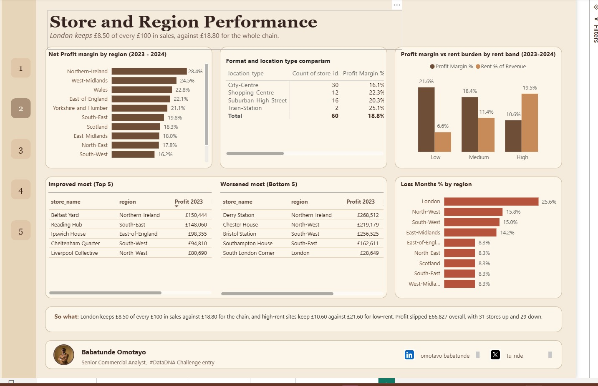
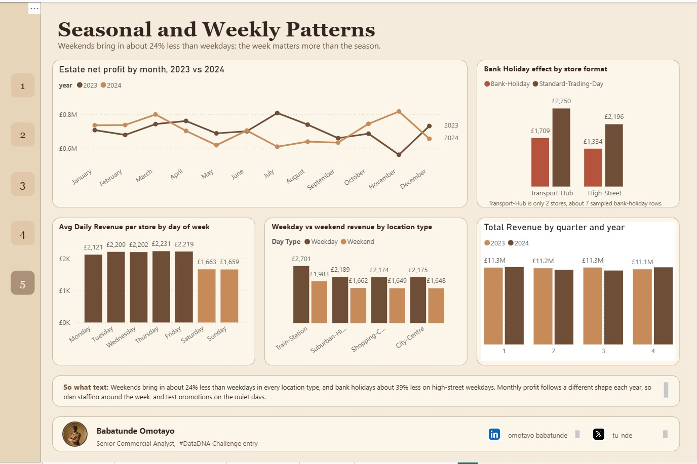

# Sunrise Coffee Chain Performance Review (Power BI)

A **#DataDNA challenge** entry. An end-to-end commercial analytics project built in Power BI Desktop, using DAX measures and a custom coffee-themed report design. The goal was to work out where a 60-store UK coffee chain makes and loses money, whether its loyalty app earns its cost, and what the 2025 expansion plan should do about it.


## The Scenario

I took the role of a senior commercial analyst reporting to the Chief Commercial Officer of Sunrise Coffee Chain (60 UK stores, trading period 2023-2024). Three decisions depend on the analysis:

1. Which regions and store types to prioritise in the 2025 site selection programme
2. Whether the loyalty programme earns a positive return
3. Which products to grow, and how to plan staffing and stock around trading patterns

## Business Questions

1. Which store types and UK regions are the most and least profitable, and which stores should be reviewed?
2. Does rent erode profit, and is it linked to higher sales?
3. Does higher loyalty adoption bring more member revenue and higher spend per visit? Do redemption costs outweigh the benefit?
4. How do espresso, filter, food and retail beans split across stores and time? Which categories earn the best margin?
5. How does trading change across the week, around bank holidays and across seasons?

## Tools Used

- Power BI Desktop
- DAX (measures and calculated columns)
- Custom JSON report theme
- SVG measure (a coffee cup that fills with profit margin)
- Slicers, cross-highlighting and page navigation buttons

## Dataset

Source: the DataDNA Sunrise Coffee Chain challenge dataset (see [`data/README.md`](data/README.md) for how to get it). Currency is GBP.

| Table | Rows | What it holds |
|---|---|---|
| `dim_store` | 60 | Format, location type, region, rent, staffing cost, loyalty adoption rate |
| `dim_product` | 40 | Category, price, cost, gross margin |
| `dim_date` | 730 | One row per day, 2023-01-01 to 2024-12-31, with weekend, bank holiday and quarter flags |
| `fact_store_monthly_profitability` | 1,440 | Store x month P&L, loyalty spend, footfall, profitability status |
| `fact_daily_sales` | 10,000 | Sample of store-days: revenue, transactions, loyalty transactions, four revenue streams |

Star schema: both fact tables link to `dim_store` on `store_id` and to `dim_date` on `date_id`. See [`docs/data_notes.md`](docs/data_notes.md) for where the real files differ from the data dictionary.

## Data Preparation

The data was already clean, so most of the work was checking it against the documentation:

- **Verified the real store formats.** The brief mentions three formats, but the data has only two: 58 High-Street and 2 Transport-Hub (both Luton). There is no Retail-Park. Comparisons therefore use **location type** and **region** instead of format
- **Treated the daily table as a sample.** It holds 10,000 of a possible 43,800 rows, so it is used only for ratios and patterns (weekday effect, mix, spend per visit), never for totals
- **Formatted `pct` columns as percentages.** They are stored as fractions (0.15 = 15%)
- **Marked `dim_date` as the date table** and sorted `month_name` by `month_number`
- **Added calculated columns**: `Adoption Band` (Low / Mid / High), `Day Number` and `Day Type` (Weekday / Weekend)
- **Used ratio measures, not averages of percentages.** Total profit divided by total revenue gives 18.8%, while averaging the margin column gives 14.6%, because the average treats a small quiet month the same as a large busy one
- **Reconciled every chart to an independently calculated value** before moving on. This caught a hidden filter that dropped the two Transport-Hub stores from a total

All measures are documented in [`docs/dax_measures.md`](docs/dax_measures.md).

## Dashboard

Five report pages with a numbered navigation strip, a year slicer and a "So what" takeaway on every page. The Key Findings view opens as an overlay from the Executive Summary ("Open Findings" button).

| Page | What it answers |
|---|---|
| 1. Executive Summary | Headline KPIs, margin cup, monthly profit, revenue mix, region margins, weekday revenue. Overlay: six findings, headline recommendation, stores to review |
| 2. Store and Region Performance | Margin by region and location type, rent burden, biggest improvers and decliners, loss months |
| 3. Loyalty Programme | Adoption, redemption cost, spend per visit, net value per store |
| 4. Revenue Mix | Mix by year and location type, gross margin by product category |
| 5. Seasonal and Weekly Patterns | Monthly profit, weekday vs weekend, bank holidays, quarters |







## Key Findings

**1. London is the weak spot.**
Across the chain, every £100 of sales leaves about £18.80 in net profit. London keeps about **£8.50**, the lowest of 12 regions, despite having the most stores (7). South London Corner lost money in 13 of 24 months and has a margin of -3.7%. London also has the highest share of loss-making store-months (25.6%).

**2. Rent squeezes profit, not a lack of customers.**
Stores in every rent band make about the same revenue (around £61,000 to £63,000 a month), but rent takes very different bites:

| Rent band | Profit margin | Rent as % of revenue |
|---|---|---|
| Low | 21.6% | 6.6% |
| Medium | 18.4% | 11.4% |
| High | 10.6% | 19.5% |

High-rent sites do not sell more, they just keep less.

**3. The loyalty app is cheap, but shows no visible uplift in spend per visit.**
Rewards cost about 5.8p per £1 of member spend (£1.73M against £29.77M). Adoption and member revenue share move almost perfectly together (the share of revenue from members tracks adoption almost exactly), but average spend per visit is about £7.28 at every adoption level, and margin stays between 18% and 19.5%. Members may simply have been buying coffee anyway. Redemption cost is also much heavier in low-adoption stores (17.2% of member revenue) than in high-adoption ones (3.9%).

**4. What people buy has not changed, and filter coffee earns the most per item.**
Espresso is about 46% of sales, food 26%, filter 19% and beans 9%, almost identical in 2023 and 2024 and across every location type. Average gross margin by category: Filter 88.3%, Espresso 83.9%, Cold Drinks 81.3%, Food 74.0%, Merchandise 70.2%, Retail Beans 67.7%.

**5. The week matters more than the season.**
Weekends bring in about 24% less than weekdays in every location type, and bank holidays about 39% less on High-Street weekdays. Monthly profit follows a different shape in 2023 and 2024, and margin by quarter stays flat between 18.4% and 19.4%.

**6. Profit was flat, but stores moved both ways.**
Estate net profit slipped from £8.47M to £8.41M (-£66,827). 31 stores improved and 29 declined, from Belfast Yard (+£116,790) to Bristol Station (-£141,297).

## Headline Recommendation

> In 2025, look first at regions that already earn strong margins, and test before expanding. Avoid expensive sites, especially in London, and review the weakest London stores first. Keep the loyalty app as it is without spending more on it. Test lower staffing at weekends and on bank holidays.

## Stores Recommended for Review

| Store | Why | Check before acting |
|---|---|---|
| South London Corner | Loss-making in 13 of 24 months, margin -3.7%, profit fell from £28,649 (2023) to a £79,144 loss (2024) | `store_status` (currently Active) |
| Canary Wharf Express | Loss-making in 10 of 24 months, margin 3.2%, among the lowest loyalty net values | `store_status` (currently Active) |
| Bristol Station | Healthy overall (26.6% margin), but profit fell £141,297 in 2024, the largest drop | Find out what changed in 2024 |
| Manchester Collective | 29.2% loss months, margin 4.9% | Already Temporarily-Closed, so a separate case from closure |

## How to Reproduce

1. Download the DataDNA Sunrise Coffee dataset (see [`data/README.md`](data/README.md)) and place the five CSV files in the `data/` folder
2. Open Power BI Desktop and import all five tables
3. Create the relationships listed in [`docs/rebuild_steps.md`](docs/rebuild_steps.md) and mark `dim_date` as the date table
4. Add the three calculated columns and all measures from [`docs/dax_measures.md`](docs/dax_measures.md)
5. Import the theme: **View > Themes > Browse for themes** and select [`theme/sunrise_coffee_theme.json`](theme/sunrise_coffee_theme.json)
6. Set the canvas to 1280 x 840 and place visuals using the layout table in [`docs/rebuild_steps.md`](docs/rebuild_steps.md)
7. Compare each chart to the checkpoint values in [`docs/verified_values.md`](docs/verified_values.md)

The finished report file goes in [`powerbi/`](powerbi/).

## A Note on Limitations

- Only 2 of 60 stores are Transport-Hubs and there are no Retail-Park stores, so format-level conclusions are not possible. Location type and region are used instead
- Some regions (West Midlands, Northern Ireland) have only 3 stores each, so strong results there are leads to investigate, not proof
- The daily table is a sample, so weekday, bank holiday and spend-per-visit results are ratios from a sample, not totals. Transport-Hub bank holiday results rest on about 7 sampled rows
- Loyalty net value (member revenue minus redemption cost) is a **ceiling**, because member revenue may not be extra revenue
- The near-perfect link between adoption and member share suggests the data was generated with a built-in rule, so the finding is stated without claiming the app causes the spend
- Two bank holiday flags exist (`is_uk_bank_holiday` marks 17 dates; `uk_trading_calendar = Bank-Holiday` covers 13, since 25 and 26 December are labelled Christmas-Period). The bank holiday analysis uses the trading calendar field

## Repository Structure

```
sunrise-coffee-datadna-powerbi/
├── README.md
├── data/
│   └── README.md              (how to get the dataset)
├── powerbi/
│   └── (place the .pbix report here)
├── theme/
│   └── sunrise_coffee_theme.json
├── docs/
│   ├── data_notes.md          (data vs dictionary differences, traps)
│   ├── dax_measures.md        (every measure and calculated column)
│   ├── verified_values.md     (checkpoint values for every chart)
│   └── rebuild_steps.md       (relationships, layout, design)
└── images/
    └── (dashboard screenshots)
```

## Contact

*Babatunde Omotayo | [LinkedIn] | [X] | [Email]*

*Built for the #DataDNA challenge.*
