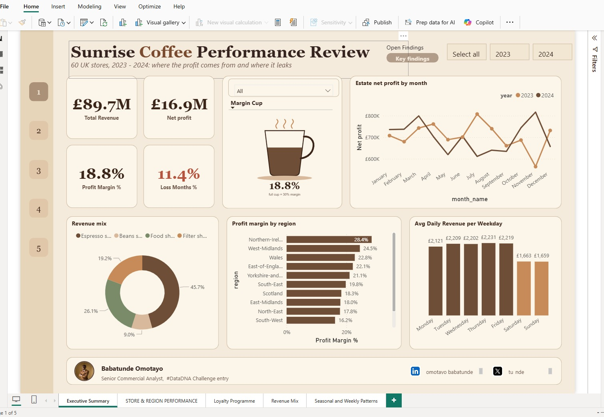
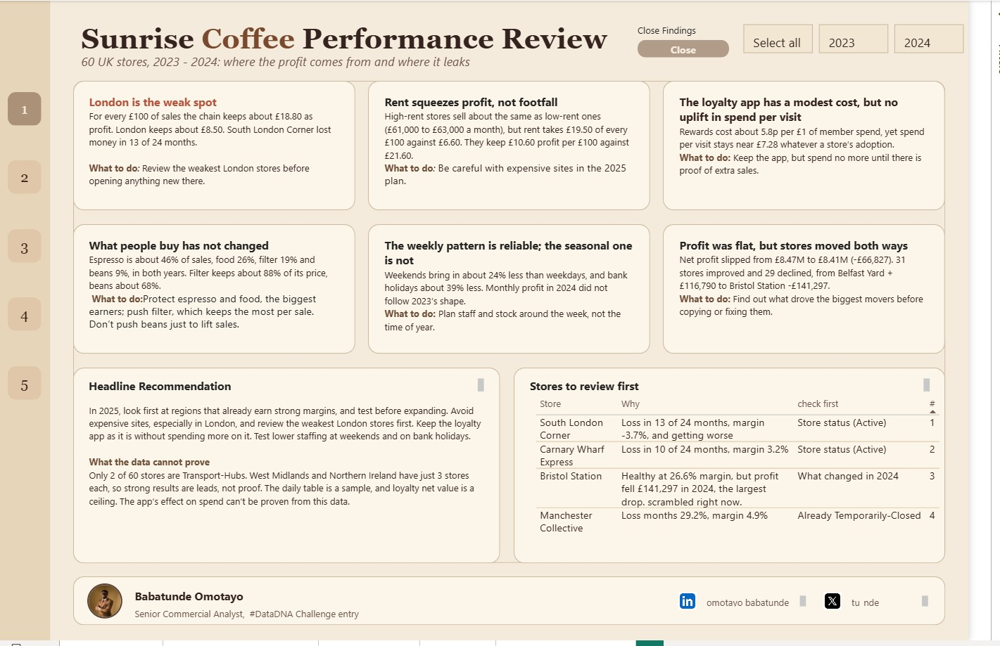
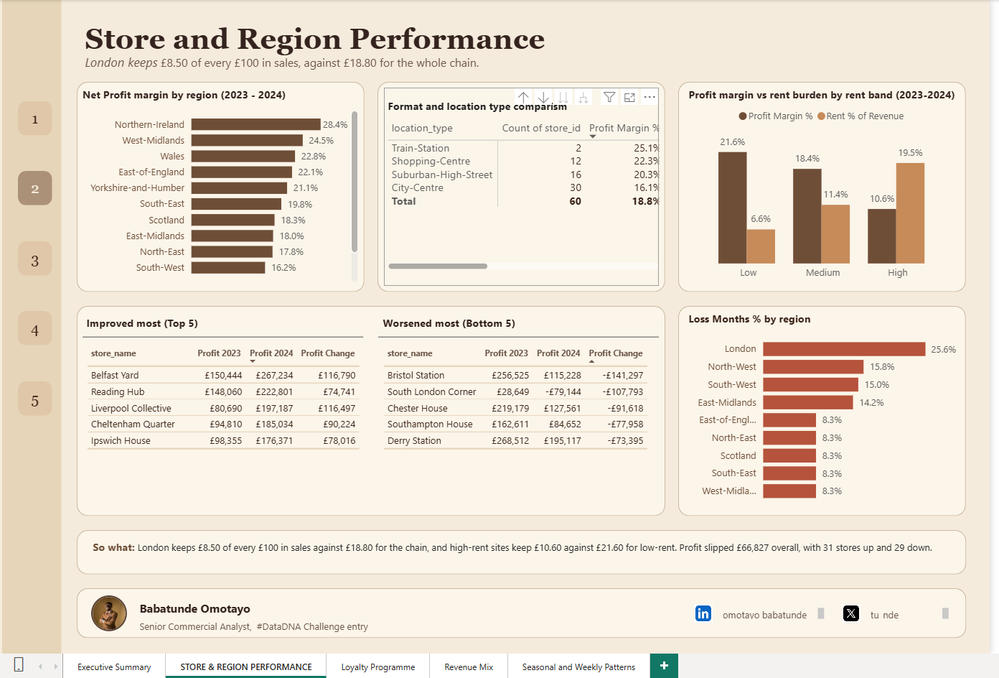
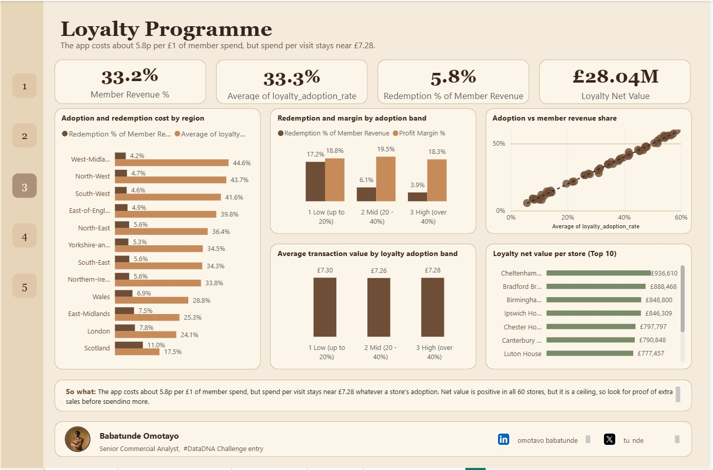
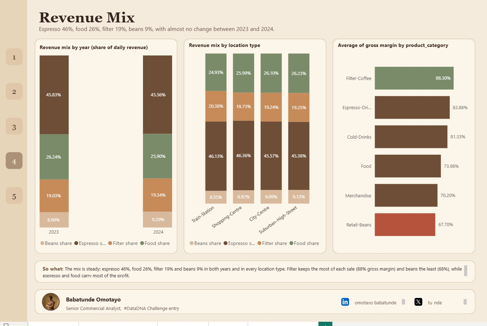
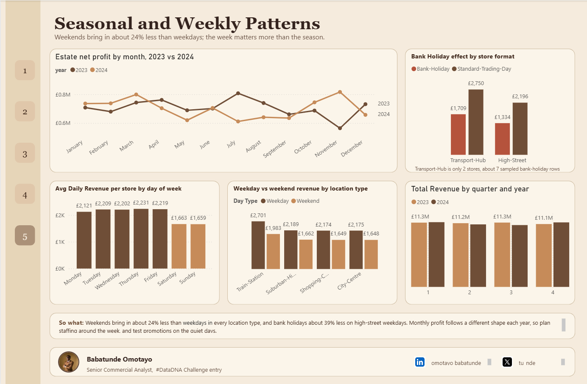
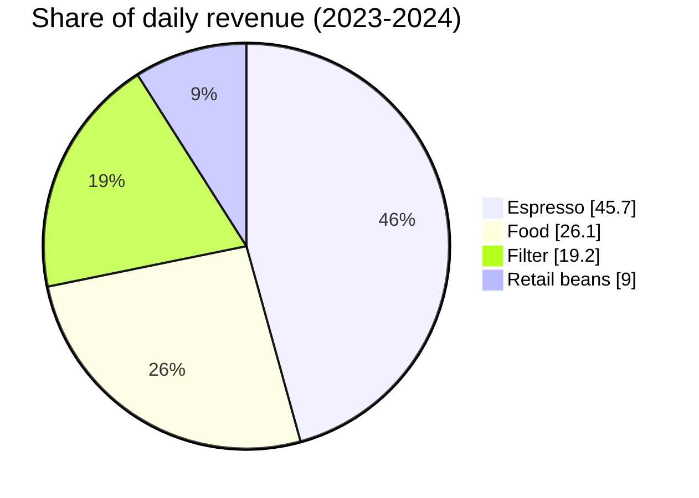
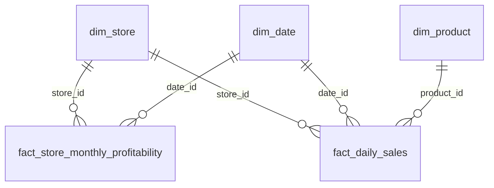

<p align="center">
  
</p>

<p align="center">
  <a href="https://www.linkedin.com/in/omotayo-babatunde"></a>
  &nbsp;&nbsp;
  <a href="https://x.com/tu_nde"></a>
</p>

<p align="center">
  
  
  
  
  
</p>

<p align="center"><b>Where does a 60-store UK coffee chain make its money, and where does it leak?</b><br>
A #DataDNA challenge entry: an end-to-end commercial analysis built in Power BI.</p>

<p align="center">
  
</p>

---

## Jump to

[At a glance](#at-a-glance) · [The scenario](#the-scenario) · [Dashboard tour](#dashboard-tour) · [Key findings](#key-findings) · [Recommendation](#headline-recommendation) · [Stores to review](#stores-recommended-for-review) · [Data and model](#dataset-and-model) · [Reproduce it](#how-to-reproduce) · [Limitations](#a-note-on-limitations) · [About](#about-the-analyst)

---

## At a glance

<table align="center">
  <tr align="center">
    <td><h2>£89.7M</h2>Total revenue</td>
    <td><h2>£16.9M</h2>Net profit</td>
    <td><h2>18.8%</h2>Profit margin</td>
    <td><h2>11.4%</h2>Store-months in loss</td>
  </tr>
  <tr align="center">
    <td><h2>8.5%</h2>London margin<br>(lowest of 12 regions)</td>
    <td><h2>10.6%</h2>Margin at high-rent sites<br>(vs 21.6% low-rent)</td>
    <td><h2>5.8p</h2>Loyalty reward cost<br>per £1 of member spend</td>
    <td><h2>-24%</h2>Weekend revenue<br>vs weekdays</td>
  </tr>
</table>

## The scenario

I took the role of a senior commercial analyst reporting to the Chief Commercial Officer of Sunrise Coffee Chain (60 UK stores, trading period 2023-2024). Three decisions depend on the analysis:

1. Which regions and store types to prioritise in the 2025 site selection programme
2. Whether the loyalty programme earns a positive return
3. Which products to grow, and how to plan staffing and stock around trading patterns

### Business questions

1. Which store types and UK regions are the most and least profitable, and which stores should be reviewed?
2. Does rent erode profit, and is it linked to higher sales?
3. Does higher loyalty adoption bring more member revenue and higher spend per visit? Do redemption costs outweigh the benefit?
4. How do espresso, filter, food and retail beans split across stores and time? Which categories earn the best margin?
5. How does trading change across the week, around bank holidays and across seasons?

### Tools used


## Dashboard tour

Five report pages with a numbered navigation strip, a year slicer and a "So what" takeaway on each. The Key Findings view opens as an overlay from the Executive Summary ("Open Findings" button). **Click a page to expand it.**

<details open>
<summary><b>1. Executive Summary</b> &nbsp;·&nbsp; KPIs, margin cup, monthly profit, revenue mix, region margins</summary>
<br>

<br><br>

</details>

<details>
<summary><b>2. Store and Region Performance</b> &nbsp;·&nbsp; margin by region, rent burden, biggest movers</summary>
<br>

</details>

<details>
<summary><b>3. Loyalty Programme</b> &nbsp;·&nbsp; adoption, redemption cost, spend per visit, net value</summary>
<br>

</details>

<details>
<summary><b>4. Revenue Mix</b> &nbsp;·&nbsp; mix by year and location, margin by category</summary>
<br>

</details>

<details>
<summary><b>5. Seasonal and Weekly Patterns</b> &nbsp;·&nbsp; weekday vs weekend, bank holidays, quarters</summary>
<br>

</details>

## Key findings

### 1. London is the weak spot

Every £100 of sales leaves about £18.80 in net profit across the chain. London keeps about **£8.50**, the lowest of 12 regions, despite having the most stores (7). It also has the highest share of loss-making store-months (25.6%). South London Corner lost money in 13 of 24 months and has a margin of -3.7%.

### 2. Rent squeezes profit, not a lack of customers

Stores in every rent band make about the same revenue (roughly £61,000 to £63,000 a month), but rent takes very different bites:

| Rent band | Profit margin | Rent as % of revenue |
|---|---|---|
| Low | 21.6% | 6.6% |
| Medium | 18.4% | 11.4% |
| High | 10.6% | 19.5% |

High-rent sites do not sell more, they just keep less.

### 3. The loyalty app is cheap, but shows no visible uplift in spend per visit

Rewards cost about 5.8p per £1 of member spend (£1.73M against £29.77M). Adoption and member revenue share rise almost in lockstep, but spend per visit is about £7.28 at every adoption level and margin stays between 18% and 19.5%. Members may simply have been buying coffee anyway. Redemption cost is also much heavier in low-adoption stores (17.2% of member revenue) than in high-adoption ones (3.9%).

| Adoption band | Stores | Redemption % of member revenue | Profit margin | Avg spend per visit |
|---|---|---|---|---|
| Low (up to 20%) | 17 | 17.2% | 18.8% | £7.30 |
| Mid (20-40%) | 19 | 6.1% | 19.5% | £7.26 |
| High (over 40%) | 24 | 3.9% | 18.3% | £7.28 |

### 4. What people buy has not changed, and filter coffee earns the most per item



The split is almost identical in 2023 and 2024 and across every location type. Average gross margin by category: Filter 88.3%, Espresso 83.9%, Cold Drinks 81.3%, Food 74.0%, Merchandise 70.2%, Retail Beans 67.7%.

### 5. The week matters more than the season

Weekends bring in about 24% less than weekdays in every location type, and bank holidays about 39% less on High-Street weekdays. Monthly profit follows a different shape in 2023 and 2024, and margin by quarter stays flat between 18.4% and 19.4%.

### 6. Profit was flat, but stores moved both ways

Estate net profit slipped from £8.47M to £8.41M (-£66,827). 31 stores improved and 29 declined, from Belfast Yard (+£116,790) to Bristol Station (-£141,297).

## Headline recommendation

> **In 2025, look first at regions that already earn strong margins, and test before expanding. Avoid expensive sites, especially in London, and review the weakest London stores first. Keep the loyalty app as it is without spending more on it. Test lower staffing at weekends and on bank holidays.**

## Stores recommended for review

| Store | Why | Check before acting |
|---|---|---|
| South London Corner | Loss-making in 13 of 24 months, margin -3.7%, profit fell from £28,649 (2023) to a £79,144 loss (2024) | `store_status` (currently Active) |
| Canary Wharf Express | Loss-making in 10 of 24 months, margin 3.2%, among the lowest loyalty net values | `store_status` (currently Active) |
| Bristol Station | Healthy overall (26.6% margin), but profit fell £141,297 in 2024, the largest drop | Find out what changed in 2024 |
| Manchester Collective | 29.2% loss months, margin 4.9% | Already Temporarily-Closed, so a separate case from closure |

## Dataset and model

Source: the DataDNA Sunrise Coffee Chain challenge dataset (see [`data/README.md`](data/README.md)). Currency is GBP.

| Table | Rows | What it holds |
|---|---|---|
| `dim_store` | 60 | Format, location type, region, rent, staffing cost, loyalty adoption rate |
| `dim_product` | 40 | Category, price, cost, gross margin |
| `dim_date` | 730 | One row per day, 2023-01-01 to 2024-12-31, with weekend, bank holiday and quarter flags |
| `fact_store_monthly_profitability` | 1,440 | Store x month P&L, loyalty spend, footfall, profitability status |
| `fact_daily_sales` | 10,000 | Sample of store-days: revenue, transactions, loyalty transactions, four revenue streams |



### Data preparation

The data was already clean, so most of the work was checking it against the documentation. See [`docs/data_notes.md`](docs/data_notes.md) for the full list.

- **Verified the real store formats.** The brief mentions three formats, but the data has only two: 58 High-Street and 2 Transport-Hub (both Luton). There is no Retail-Park, so comparisons use **location type** and **region** instead
- **Treated the daily table as a sample.** It holds 10,000 of a possible 43,800 rows, so it is used only for ratios and patterns, never for totals
- **Formatted `pct` columns as percentages.** They are stored as fractions (0.15 = 15%)
- **Marked `dim_date` as the date table** and sorted `month_name` by `month_number`
- **Added calculated columns:** `Adoption Band`, `Day Number` and `Day Type`
- **Used ratio measures, not averages of percentages.** Total profit divided by total revenue gives 18.8%, while averaging the margin column gives 14.6%, because the average treats a small quiet month the same as a large busy one
- **Reconciled every chart to an independently calculated value.** This caught a hidden filter that dropped the two Transport-Hub stores from a total

All measures are in [`docs/dax_measures.md`](docs/dax_measures.md).

## How to reproduce

1. Download the DataDNA Sunrise Coffee dataset (see [`data/README.md`](data/README.md)) and place the five files in the `data/` folder
2. Open Power BI Desktop and import all five tables
3. Create the relationships in [`docs/rebuild_steps.md`](docs/rebuild_steps.md) and mark `dim_date` as the date table
4. Add the calculated columns and measures from [`docs/dax_measures.md`](docs/dax_measures.md)
5. Import the theme: **View > Themes > Browse for themes**, then select [`theme/sunrise_coffee_theme.json`](theme/sunrise_coffee_theme.json)
6. Set the canvas to 1280 x 840 and place visuals using the layout table in [`docs/rebuild_steps.md`](docs/rebuild_steps.md)
7. Check each chart against the values in [`docs/verified_values.md`](docs/verified_values.md)

The finished report file goes in [`powerbi/`](powerbi/).

## A note on limitations

- Only 2 of 60 stores are Transport-Hubs and there are no Retail-Park stores, so format-level conclusions are not possible
- Some regions (West Midlands, Northern Ireland) have only 3 stores each, so strong results there are leads to investigate, not proof
- The daily table is a sample, so weekday, bank holiday and spend-per-visit results are ratios from a sample. Transport-Hub bank holiday results rest on about 7 sampled rows
- Loyalty net value (member revenue minus redemption cost) is a **ceiling**, because member revenue may not be extra revenue
- The near-perfect link between adoption and member share suggests the data was generated with a built-in rule, so the finding is stated without claiming the app causes the spend
- Two bank holiday flags exist (`is_uk_bank_holiday` marks 17 dates; `uk_trading_calendar = Bank-Holiday` covers 13). The analysis uses the trading calendar field

## Repository structure

```
├── README.md
├── assets/                    animated banner and social icons
├── data/                      how to get the dataset
├── powerbi/                   place the .pbix report here
├── theme/sunrise_coffee_theme.json
├── docs/
│   ├── data_notes.md
│   ├── dax_measures.md
│   ├── verified_values.md
│   └── rebuild_steps.md
└── images/                    dashboard screenshots
```

## About the analyst

<table>
  <tr>
    <td width="160" align="center">
     
    </td>
    <td>
      <h3>Babatunde Omotayo</h3>
      Senior Commercial Analyst · #DataDNA challenge entry<br><br>
      Turning raw trading data into decisions: business question, clean model, verified numbers, clear recommendation.
      <br><br>
      <a href="https://www.linkedin.com/in/YOUR-LINKEDIN-HANDLE"></a>
      &nbsp;
      <a href="https://x.com/YOUR-X-HANDLE"></a>
    </td>
  </tr>
</table>

<p align="center"><sub>Built for the #DataDNA challenge · If this was useful, a ⭐ on the repo is appreciated</sub></p>
